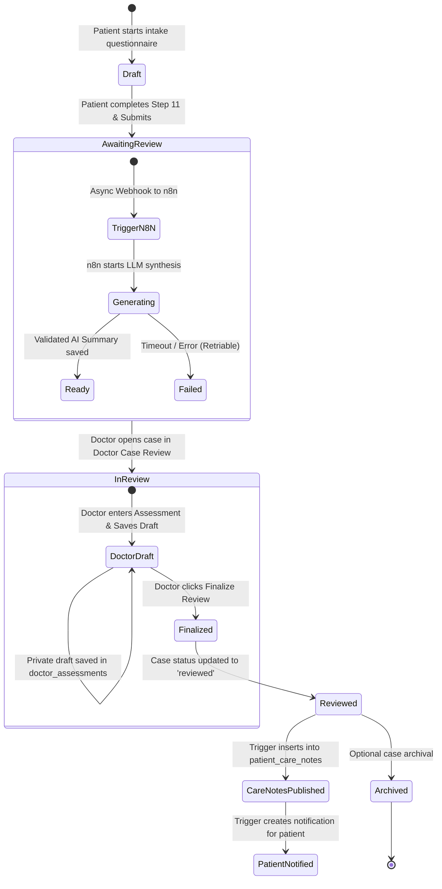

# CLINOVA — SUPABASE DATABASE ARCHITECTURE & SCHEMA DESIGN

**Design Document Version**: 1.0  
**Target Engine**: PostgreSQL 15+ / Supabase  
**Security Architecture**: Row-Level Security (RLS) with Role-Based Access Control (RBAC)  
**Deliverable File**: `clinova_supabase_setup.sql`  

---

## 1. Executive Design Summary & Table Count

Based on the comprehensive codebase audit of the Clinova Flutter application, the recommended backend architecture consists of **exactly 9 relational tables**.

This number is neither arbitrary nor predetermined:
- It **normalizes** patient demographics, doctor credentials, case workflows, and clinical responses.
- It **isolates** private physician draft notes from patient-visible published care instructions.
- It **decouples** lightweight case queue queries from heavy 11-step questionnaire data.
- It **protects** clinical records from being overwritten or contaminated by AI-generated decision-support summaries.
- It **enforces** strict healthcare data protection boundaries via PostgreSQL Row-Level Security (RLS).

### Entity Overview Table

| # | Table Name | Purpose in Clinova | Cardinality / Foreign Key | Sensitive / PII |
|---|---|---|---|:---:|
| 1 | `profiles` | Base user identity & system role (`patient` vs `doctor`) | 1:1 with `auth.users(id)` | Yes |
| 2 | `patient_profiles` | Patient demographics, physical traits & clinical anamnesis | 1:1 with `profiles(id)` | Yes |
| 3 | `doctor_profiles` | Clinical qualifications, license & practice facility | 1:1 with `profiles(id)` | Yes |
| 4 | `cases` | Case metadata, status queue, reference & doctor assignment | N:1 with `profiles` | Yes |
| 5 | `case_intake_responses` | Full 11-step questionnaire answers & structured history | 1:1 with `cases(id)` | Yes |
| 6 | `ai_case_summaries` | AI decision-support executive briefing & timeline via n8n | 1:1 with `cases(id)` | Yes |
| 7 | `doctor_assessments` | Physician clinical evaluation, observations & private drafts | 1:1 with `cases(id)` | Yes |
| 8 | `patient_care_notes` | Published, read-only consultation instructions for patient | N:1 with `cases(id)` | Yes |
| 9 | `notifications` | Real-time in-app alerts (review ready, status updates) | N:1 with `profiles(id)` | Low |

---

## 2. Table-by-Table Technical Specifications

### Table 1: `public.profiles`
- **Application Source**: `UserSession` (`lib/core/auth/auth_models.dart`), `DemoAuthService`.
- **Purpose**: Bridge between Supabase Auth (`auth.users`) and application-layer user metadata. Defines the immutable system role.
- **Primary Key**: `id UUID REFERENCES auth.users(id) ON DELETE CASCADE`.
- **Key Columns**:
  - `role`: `TEXT CHECK (role IN ('patient', 'doctor')) NOT NULL DEFAULT 'patient'`.
  - `email`: `TEXT NOT NULL UNIQUE`.
  - `full_name`: `TEXT NOT NULL`.
  - `avatar_url`: `TEXT` (Supabase Storage reference).
  - `created_at`, `updated_at`: `TIMESTAMPTZ`.
- **Security Rule**: Users can SELECT their own profile. Doctors can SELECT basic patient profile info only for assigned or open cases. Role elevation to `doctor` requires administrative verification.

---

### Table 2: `public.patient_profiles`
- **Application Source**: `PatientProfileModel` (`lib/features/dashboard/patient/models/patient_profile_model.dart`).
- **Purpose**: Stores complete patient demographics, emergency contact info, and baseline medical anamnesis (conditions, allergies, surgical history, family history, lifestyle).
- **Primary Key**: `patient_id UUID REFERENCES public.profiles(id) ON DELETE CASCADE`.
- **Key Columns**:
  - Demographics: `date_of_birth DATE`, `gender TEXT`, `blood_group TEXT`, `mobile_number TEXT`, `home_address TEXT`, `height_cm TEXT`, `weight_kg TEXT`.
  - Emergency Contact: `emergency_contact_name TEXT`, `emergency_contact_relationship TEXT`, `emergency_contact_phone TEXT`.
  - Baseline Anamnesis: `allergies TEXT`, `conditions TEXT`, `medications TEXT`, `past_medical_history TEXT`, `surgical_history TEXT`, `family_history TEXT`, `lifestyle TEXT`, `additional_notes TEXT`, `is_anamnesis_customized BOOLEAN DEFAULT FALSE`.
  - `updated_at`: `TIMESTAMPTZ`.
- **Security Rule**: Patients have full CRUD on their own profile (`patient_id = auth.uid()`). Doctors can read the profile only if assigned to an active case for that patient.

---

### Table 3: `public.doctor_profiles`
- **Application Source**: `DoctorProfileModel` (`lib/features/dashboard/doctor/models/doctor_profile_model.dart`).
- **Purpose**: Stores physician professional credentials, license verification status, clinical specialty, and practice facility.
- **Primary Key**: `doctor_id UUID REFERENCES public.profiles(id) ON DELETE CASCADE`.
- **Key Columns**:
  - `specialty TEXT NOT NULL`, `qualification TEXT NOT NULL`, `years_of_experience TEXT`, `license_number TEXT NOT NULL`, `is_license_verified BOOLEAN DEFAULT FALSE NOT NULL`.
  - Contact & Clinic: `phone TEXT`, `hospital_name TEXT`, `clinic_address TEXT`, `practice_status TEXT DEFAULT 'Active'`.
  - `updated_at`: `TIMESTAMPTZ`.
- **Security Rule**: Any authenticated user can view verified doctor profiles (for practitioner attribution). Only the doctor can edit their contact details. **`is_license_verified` cannot be modified by the doctor directly** (guarded by trigger/service role).

---

### Table 4: `public.cases`
- **Application Source**: `PatientCaseSummary` (`lib/features/dashboard/patient/services/demo_case_repository.dart`).
- **Purpose**: Central routing entity for patient consultations. Powers Doctor Case Queue filters (`Pending`, `In Review`, `Reviewed`, `Archived`) and Patient Case History lists.
- **Primary Key**: `id UUID DEFAULT gen_random_uuid()`.
- **Foreign Keys**:
  - `patient_id UUID REFERENCES public.profiles(id) ON DELETE CASCADE NOT NULL`.
  - `assigned_doctor_id UUID REFERENCES public.doctor_profiles(doctor_id) ON DELETE SET NULL`.
- **Key Columns**:
  - `case_reference TEXT UNIQUE NOT NULL` (e.g. `CASE-2026-8842`).
  - `title TEXT NOT NULL` (Chief concern / clinical category headline).
  - `category TEXT NOT NULL` (`Respiratory`, `Musculoskeletal`, `General Health`, etc.).
  - `status TEXT NOT NULL DEFAULT 'awaiting_review'` (`draft`, `submitted`, `awaiting_review`, `in_review`, `reviewed`, `archived`).
  - Timestamps: `submitted_at TIMESTAMPTZ`, `reviewed_at TIMESTAMPTZ`, `archived_at TIMESTAMPTZ`, `created_at TIMESTAMPTZ`, `updated_at TIMESTAMPTZ`.
- **Indexes**:
  - `idx_cases_patient_id` on `(patient_id)`
  - `idx_cases_status` on `(status)`
  - `idx_cases_assigned_doctor` on `(assigned_doctor_id)`
- **Security Rule**: Patients can read and create their own cases. Verified doctors can view open/awaiting cases in the queue and cases assigned to them. Doctors can update status to `in_review` or `reviewed`.

---

### Table 5: `public.case_intake_responses`
- **Application Source**: `CaseIntakeModel` (`lib/features/dashboard/patient/models/case_intake_model.dart`).
- **Purpose**: Stores the comprehensive 11-step clinical questionnaire responses. Normalizing this away from `cases` prevents large text fields and JSON blobs from slowing down high-frequency queue lookups.
- **Primary Key**: `case_id UUID REFERENCES public.cases(id) ON DELETE CASCADE`.
- **Key Columns**:
  - Step 1: `chief_concern TEXT NOT NULL`.
  - Step 2: `duration TEXT NOT NULL`.
  - Step 3: `severity TEXT NOT NULL`.
  - Step 4: `associated_symptoms TEXT[] DEFAULT '{}'`, `other_associated_symptom TEXT`.
  - Step 5: `symptom_details TEXT`.
  - Step 6: `previous_occurrences TEXT`, `previous_occurrence_details TEXT`.
  - Step 7: `existing_conditions TEXT[] DEFAULT '{}'`, `other_condition_details TEXT`.
  - Step 8: `allergies TEXT[] DEFAULT '{}'`, `allergy_details TEXT`.
  - Step 9: `takes_medications TEXT`, `medication_details TEXT`.
  - Step 10: `medical_family_history TEXT`.
  - Metadata: `current_step INT DEFAULT 11`, `is_draft BOOLEAN DEFAULT FALSE`, `raw_responses JSONB`, `created_at TIMESTAMPTZ`, `updated_at TIMESTAMPTZ`.
- **Security Rule**: Inherits access from `cases`. Only the case owner (patient) or attending/reviewing doctor can read. Modifiable by patient only while `is_draft = TRUE`.

---

### Table 6: `public.ai_case_summaries`
- **Application Source**: `AiCaseSummaryModel` (`lib/features/dashboard/doctor/models/ai_case_summary_model.dart`), `AiCaseSummaryRepository`.
- **Purpose**: Stores structured AI-generated clinical decision-support summaries processed via n8n.
- **Primary Key**: `id UUID DEFAULT gen_random_uuid()`.
- **Foreign Key**: `case_id UUID UNIQUE REFERENCES public.cases(id) ON DELETE CASCADE NOT NULL`.
- **Key Columns**:
  - `generation_status TEXT NOT NULL DEFAULT 'pending' CHECK (generation_status IN ('pending', 'generating', 'ready', 'failed'))`.
  - Structured Findings: `summary_text TEXT`, `chief_complaint TEXT`, `symptom_timeline_and_severity TEXT`, `relevant_positive_findings TEXT[] DEFAULT '{}'`, `relevant_negative_findings TEXT[] DEFAULT '{}'`, `medical_history_and_medications TEXT`, `missing_or_unclear_information TEXT[] DEFAULT '{}'`.
  - Operational: `error_message TEXT`, `disclaimer TEXT NOT NULL DEFAULT 'AI-generated summary — requires physician review. Not a diagnosis or prescription.'`, `last_requested_at TIMESTAMPTZ NOT NULL DEFAULT now()`, `generated_at TIMESTAMPTZ`, `created_at TIMESTAMPTZ`, `updated_at TIMESTAMPTZ`.
- **Security Rule**: Visible only to verified doctors reviewing the case. **Not visible to patients** (decision-support material only). Modifiable only by the trusted n8n service-role or attending doctor re-running generation.

---

### Table 7: `public.doctor_assessments`
- **Application Source**: `DoctorAssessmentModel` (`lib/features/dashboard/doctor/models/doctor_assessment_model.dart`), `DoctorAssessmentRepository`.
- **Purpose**: Stores the attending physician's clinical evaluation, observations, recommendations, and follow-up plan.
- **Primary Key**: `id UUID DEFAULT gen_random_uuid()`.
- **Foreign Keys**:
  - `case_id UUID UNIQUE REFERENCES public.cases(id) ON DELETE CASCADE NOT NULL`.
  - `doctor_id UUID REFERENCES public.profiles(id) NOT NULL`.
- **Key Columns**:
  - `clinical_assessment TEXT DEFAULT ''`.
  - `observations TEXT DEFAULT ''`.
  - `advice_and_recommendations TEXT DEFAULT ''`.
  - `follow_up_instructions TEXT DEFAULT ''`.
  - `follow_up_date DATE`.
  - Workflow: `is_finalized BOOLEAN NOT NULL DEFAULT FALSE`, `finalized_at TIMESTAMPTZ`, `last_saved_at TIMESTAMPTZ NOT NULL DEFAULT now()`, `created_at TIMESTAMPTZ`, `updated_at TIMESTAMPTZ`.
- **Critical Healthcare Boundary**: Draft records (`is_finalized = FALSE`) are strictly private to the authoring doctor. A database trigger publishes finalized records to `patient_care_notes` and marks the case as `reviewed`.

---

### Table 8: `public.patient_care_notes`
- **Application Source**: `PatientCareNote` (`lib/features/dashboard/patient/models/patient_care_note_model.dart`), `PatientCareNotesRepository`.
- **Purpose**: Stores finalized clinical care notes and recommendations accessible to the patient.
- **Primary Key**: `id UUID DEFAULT gen_random_uuid()`.
- **Foreign Keys**:
  - `case_id UUID REFERENCES public.cases(id) ON DELETE CASCADE NOT NULL`.
  - `patient_id UUID REFERENCES public.profiles(id) ON DELETE CASCADE NOT NULL`.
  - `doctor_id UUID REFERENCES public.profiles(id) NOT NULL`.
- **Key Columns**:
  - `author_name TEXT NOT NULL` (e.g. "Dr. Marcus Vance").
  - `category TEXT NOT NULL` (e.g. "Clinical Consultation").
  - `note_text TEXT NOT NULL` (Formatted clinical guidance & instructions).
  - `published_at TIMESTAMPTZ NOT NULL DEFAULT now()`.
  - `created_at TIMESTAMPTZ DEFAULT now()`.
- **Security Rule**: Patients have read-only access to their own notes (`patient_id = auth.uid()`). Patients cannot create, update, or delete care notes. Only doctors finalising reviews can insert.

---

### Table 9: `public.notifications`
- **Application Source**: `PatientNotificationsSheet` (`lib/features/dashboard/patient/widgets/patient_notifications_sheet.dart`).
- **Purpose**: Powers the responsive in-app notification sheet and drawer badge for both patients and doctors.
- **Primary Key**: `id UUID DEFAULT gen_random_uuid()`.
- **Foreign Keys**:
  - `user_id UUID REFERENCES public.profiles(id) ON DELETE CASCADE NOT NULL`.
  - `case_id UUID REFERENCES public.cases(id) ON DELETE SET NULL`.
- **Key Columns**:
  - `title TEXT NOT NULL`.
  - `message TEXT NOT NULL`.
  - `category TEXT NOT NULL CHECK (category IN ('SYSTEM', 'CASE', 'DOCTOR'))`.
  - `is_read BOOLEAN NOT NULL DEFAULT FALSE`.
  - `created_at TIMESTAMPTZ NOT NULL DEFAULT now()`.
- **Security Rule**: Users can SELECT and UPDATE (`is_read`) only their own notifications (`user_id = auth.uid()`). Inserts are handled via automated database triggers or server-side workflows.

---

## 3. Data Flow & Lifecycle State Machine

---

## 4. Security, RLS & Authorization Guarantees

1. **Role Enforcement (`auth.users` -> `public.profiles`)**:
   - `public.get_user_role(auth.uid())` security definer function returns the authentic role.
   - Prevents patients from spoofing headers or declaring doctor permissions.
2. **Physician License Protection**:
   - `is_license_verified` in `doctor_profiles` is locked: an update trigger rejects changes to this column by standard client connections.
3. **Draft Privacy**:
   - RLS on `doctor_assessments` denies SELECT to anyone whose role is not `doctor`.
   - Patients can only ever see finalized notes via `patient_care_notes`.
4. **AI Output Isolation**:
   - `ai_case_summaries` records are stored in their own isolated table.
   - They cannot overwrite `doctor_assessments` or `patient_care_notes`.
5. **No Blind Doctor Queuing**:
   - Doctors can only see submitted cases awaiting review or explicitly assigned to their department/ID.
